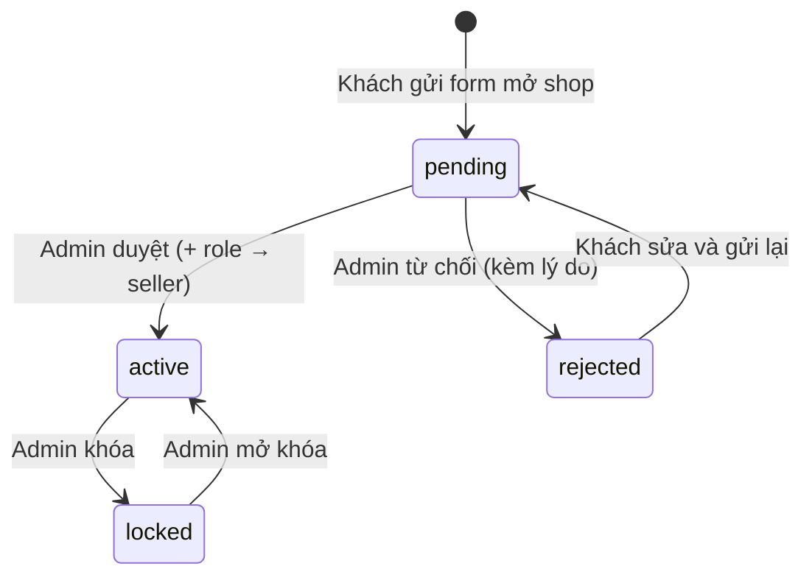
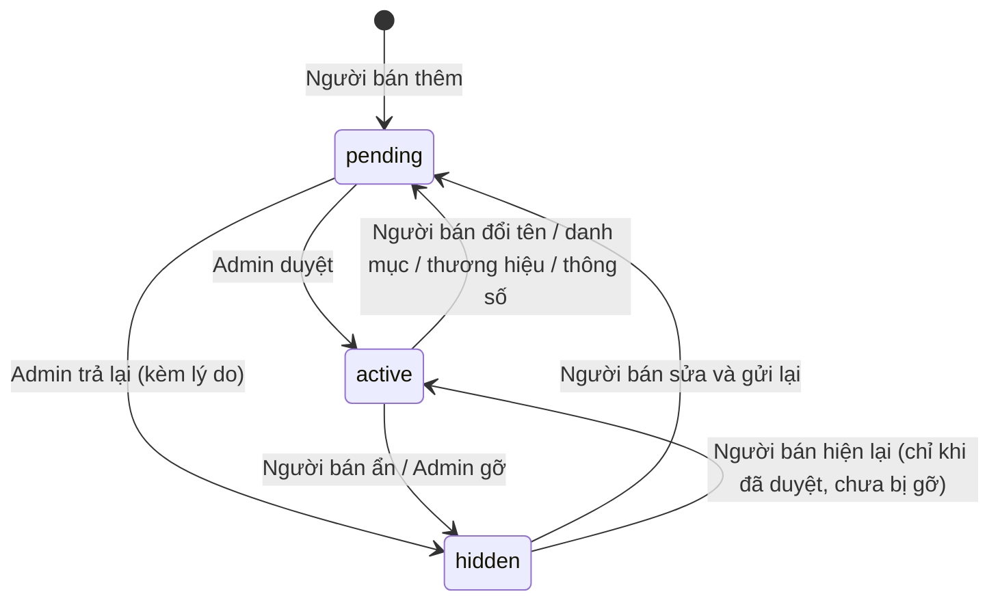

# User story – Giai đoạn 2 (F13–F18, F12, F11)

Người phụ trách: BA · Dùng cho: Dev1/Dev2/Dev3/KTS (làm tính năng), Test1/Test2 (test case).
Phiên bản 1.5 – Tuần 5 giai đoạn 2 (1.1: thêm F12 thông báo trong web và email thay Zalo OA; 1.2: chốt C1–C5; 1.3: chốt C6–C8 sau QA G2T3; 1.4: chốt C9–C11 cho F16; 1.5: thêm F11 thu cũ đổi mới). Phạm vi theo tài liệu "Kế hoạch code giai đoạn 2" (27/10/2026).

Liên quan:

- Danh sách thông số bắt buộc khi người bán đăng sản phẩm: [thong-so-bat-buoc.md](thong-so-bat-buoc.md)
- Bộ dữ liệu đơn vị hành chính và kết luận Zalo OA: [g2-ba-tuan1.md](g2-ba-tuan1.md)
- Bảng giá thu cũ đổi mới (F11): [g2-ba-tuan5-thu-cu.md](g2-ba-tuan5-thu-cu.md)

Quy ước:

- Mỗi tiêu chí viết dạng **Given / When / Then**. Test1 viết test case từ đúng các dòng này.
- Tiêu chí có đánh dấu **[DB]** phải đúng cả khi gọi thẳng Supabase bằng anon key + token của vai trò đó (không qua giao diện). Test2 kiểm bằng `npm run test:rls`.
- **Tuần** = tuần mà tính năng phải chạy được trên Vercel theo kế hoạch.
- Mục **Đã chốt** ở cuối file ghi các quyết định C1–C11 (BA đề xuất, KTS/PM chốt) và việc cần làm kèm theo.

## Vai trò

| Vai trò        | Giá trị `profiles.role` | Trang riêng       | Ghi chú                                                      |
| -------------- | ----------------------- | ----------------- | ------------------------------------------------------------ |
| Khách vãng lai | (chưa đăng nhập)        | –                 | Xem, tìm, Builder, giỏ hàng; không đặt hàng, không bình luận |
| Khách hàng     | `customer`              | `/tai-khoan`      | Mặc định khi đăng ký                                         |
| Người bán      | `seller`                | `/kenh-nguoi-ban` | Có mọi quyền của khách hàng + quản lý shop của mình          |
| Admin          | `admin`                 | `/admin`          | Không mua hàng trên tài khoản admin khi demo                 |

---

## F13 – Phân quyền 3 vai trò (Must, Tuần 1)

### US-13.1: Là người dùng, tôi muốn chỉ thấy menu đúng với vai trò của mình để không bấm nhầm vào trang không dùng được.

- Given chưa đăng nhập, When mở bất kỳ trang nào, Then Header có "Đăng nhập", không có "Tài khoản", "Kênh người bán", "Quản trị".
- Given đăng nhập là khách hàng, Then menu tài khoản có "Tài khoản", "Đơn hàng", "Mở shop"; không có "Kênh người bán", "Quản trị".
- Given đăng nhập là người bán, Then có thêm "Kênh người bán"; không có "Mở shop", "Quản trị".
- Given đăng nhập là admin, Then có "Quản trị".
- Given đang mở trang, When admin đổi vai trò của tôi, Then sau khi tải lại trang (F5) menu đổi theo vai trò mới.
- Menu trên điện thoại 360 px giống hệt máy tính (cùng mục, cùng thứ tự).

### US-13.2: Là chủ hệ thống, tôi muốn người dùng bị chặn khi mở trang không thuộc vai trò của họ.

- Given chưa đăng nhập, When gõ thẳng `/admin` hoặc `/kenh-nguoi-ban`, Then chuyển sang `/dang-nhap?next=...`; đăng nhập xong quay lại đúng trang đã gõ (nếu đúng vai trò).
- Given là khách hàng, When gõ `/admin` hoặc `/kenh-nguoi-ban/...`, Then hiện "Không có quyền truy cập", không hiện bất kỳ dữ liệu nào của trang đó (kể cả chớp qua lúc đang tải).
- Given là người bán, When gõ `/admin/...`, Then hiện "Không có quyền truy cập".
- Given là admin, When mở `/kenh-nguoi-ban`, Then hiện "Không có quyền truy cập" (admin quản lý sản phẩm HcmusWare ở `/admin`, xem C5).
- Given lỗi mạng khi tải hồ sơ, Then hiện thông báo lỗi và nút "Thử lại", không coi là khách hàng.

### US-13.3: Là chủ hệ thống, tôi muốn quyền được kiểm tra trong DB để không ai vượt quyền bằng cách gọi API trực tiếp.

- **[DB]** Given token khách hàng, When `update profiles set role = 'admin'` cho chính mình, Then bị từ chối, role không đổi.
- **[DB]** Given token khách hàng, When thêm/sửa/xóa `products`, `brands`, `categories`, Then bị từ chối.
- **[DB]** Given token người bán A, When sửa sản phẩm của shop B (kể cả shop HcmusWare), Then bị từ chối.
- **[DB]** Given token người bán, When tự đổi `shops.status` của shop mình sang `active` hoặc đổi `owner_id`, Then bị từ chối.
- **[DB]** Given anon key không đăng nhập, When đọc `products`, Then chỉ ra sản phẩm `status = 'active'` của shop `active`.
- **[DB]** Given token khách hàng, When gọi `admin_list_users` hoặc `set_user_role`, Then bị từ chối.
- Toàn bộ e2e giai đoạn 1 (`npm run test:e2e`) vẫn đạt sau migration.

### US-13.4: Là admin, tôi muốn đổi vai trò người dùng để cấp hoặc thu quyền.

- Given ở trang admin "Người dùng", Then thấy danh sách: email, họ tên, vai trò, ngày đăng ký, shop (nếu có, kèm trạng thái); tìm được theo email hoặc tên.
- When chọn vai trò mới và xác nhận, Then vai trò đổi, có thông báo thành công, danh sách cập nhật không cần tải lại.
- Given dòng của chính mình, Then không đổi được vai trò (ô bị khóa, kèm lý do).
- Given hạ một người bán xuống khách hàng, Then người đó mất quyền ghi sản phẩm ngay (**[DB]**), sản phẩm của shop vẫn còn và vẫn hiện nếu shop đang hoạt động.

---

## F14 – Người bán đăng sản phẩm (Must, Tuần 2; đơn hàng Tuần 3)

Luồng đầy đủ xem mục [Luồng mở shop và duyệt sản phẩm](#luồng-mở-shop-và-duyệt-sản-phẩm).

### US-14.1: Là khách hàng, tôi muốn đăng ký mở shop để bán linh kiện trên HcmusWare.

- Given là khách hàng chưa có shop, When bấm "Mở shop", Then thấy form: tên shop (bắt buộc, 2–80 ký tự), mô tả (không bắt buộc, ≤ 2000 ký tự), logo (không bắt buộc, ảnh ≤ 2 MB), ô đồng ý "Quy định người bán".
- When gửi form hợp lệ, Then shop được tạo ở trạng thái **Chờ duyệt**, trang `/tai-khoan` hiện "Shop … đang chờ admin duyệt".
- Given tên shop trùng shop khác (so sánh không phân biệt hoa thường, không dấu), Then báo "Tên shop đã có người dùng", không tạo shop.
- Given đã có shop (bất kỳ trạng thái nào), Then không thấy nút "Mở shop" nữa. **[DB]** Gửi thẳng lệnh tạo shop thứ hai bị từ chối.
- Given shop bị **Từ chối**, Then `/tai-khoan` hiện lý do và nút "Sửa và gửi lại": sửa tên, mô tả, logo rồi gửi thì shop về **Chờ duyệt** (C2).
- **[DB]** Gửi thẳng `status: 'active'` khi tạo shop, Then shop vẫn ở `pending`.
- Đường dẫn shop (`slug`) tạo tự động từ tên, bỏ dấu: "Linh Kiện Sài Gòn" → `linh-kien-sai-gon`.

### US-14.2: Là admin, tôi muốn duyệt hoặc từ chối đăng ký shop để chỉ người bán đáng tin mới được bán.

- Given ở `/admin/duyet`, tab "Shop", Then thấy shop chờ duyệt, cũ nhất ở trên: tên, mô tả, logo, email chủ shop, ngày đăng ký; trên tab có số lượng chờ duyệt.
- When bấm "Duyệt", Then **trong cùng một thao tác** (hàm `approve_shop`, C4): shop chuyển **Hoạt động** và chủ shop thành `seller`. Không có trạng thái "shop hoạt động mà chủ vẫn là customer".
- Chủ shop đăng nhập lại (hoặc F5) thì thấy "Kênh người bán".
- When bấm "Từ chối" và nhập lý do (bắt buộc, ≤ 500 ký tự), Then shop chuyển **Từ chối** (`rejected`), lý do lưu ở `shops.review_note`; khách hàng thấy lý do ở `/tai-khoan` (C2).
- **[DB]** Chủ shop chỉ được tự đổi trạng thái theo đúng một chiều `rejected` → `pending` (gửi lại); mọi đổi trạng thái khác bị từ chối.

### US-14.3: Là admin, tôi muốn khóa shop vi phạm để dừng bán ngay.

- When admin bấm "Khóa shop" và xác nhận, Then shop thành **Bị khóa**; mọi sản phẩm của shop biến mất khỏi danh sách, tìm kiếm, trang thương hiệu và Builder; trang `/shop/:slug` trả 404.
- **[DB]** Người bán của shop bị khóa không thêm/sửa sản phẩm được, kể cả gọi API thẳng.
- Khách đã mua hàng của shop vẫn xem được đơn cũ kèm tên, ảnh sản phẩm.
- Sản phẩm của shop bị khóa đang nằm trong giỏ: khi đặt hàng bị chặn với thông báo "Sản phẩm … hiện không còn bán".
- When admin "Mở khóa", Then shop và các sản phẩm đã duyệt hiện lại như cũ.
- Shop HcmusWare không khóa được (nút ẩn, **[DB]** bị chặn).

### US-14.4: Là người bán, tôi muốn đăng sản phẩm có đủ ảnh và thông số để khách mua được và Builder kiểm tra được tương thích.

- Given ở `/kenh-nguoi-ban/san-pham/moi`, When chọn danh mục, Then form hiện đúng các ô thông số của danh mục đó theo [thong-so-bat-buoc.md](thong-so-bat-buoc.md): ô chọn cho giá trị cố định (socket, chuẩn RAM...), ô số có đơn vị cho số đo.
- Ô bắt buộc để trống hoặc sai khoảng, Then không lưu được, báo lỗi ngay dưới đúng ô đó, con trỏ nhảy tới ô lỗi đầu tiên.
- Ảnh: 1–5 ảnh, mỗi ảnh ≤ 2 MB, chỉ JPG/PNG/WebP; ảnh đầu tiên là ảnh đại diện. Ảnh quá cỡ báo "Ảnh … lớn hơn 2 MB" và không tải lên.
- Thương hiệu (C1): chọn từ danh sách admin quản lý; người bán **không** tạo được thương hiệu. Chưa có trong danh sách thì chọn "Thương hiệu khác" và gõ tên (lưu vào `products.brand`, `brand_id` để trống); admin thêm thương hiệu khi duyệt.
- Giá: số nguyên VNĐ 1.000 – 200.000.000; tồn kho: số nguyên 0 – 9.999.
- When lưu, Then sản phẩm ở trạng thái **Chờ duyệt**, hiện trong danh sách của kênh người bán với nhãn vàng; **không** hiện với khách và **không** có trong Builder.
- **[DB]** Gửi thẳng `status: 'active'` khi thêm, Then vẫn là `pending`. Gửi `shop_id` của shop khác, Then bị từ chối.
- **[DB]** Người bán chỉ tải ảnh được vào thư mục `product-images/<shop_id của mình>/`.

### US-14.5: Là admin, tôi muốn duyệt sản phẩm mới để thông số sai không làm Builder báo sai.

- Given ở `/admin/duyet`, tab "Sản phẩm", Then thấy sản phẩm chờ duyệt: ảnh, tên, shop, danh mục, giá, bảng thông số đầy đủ; thông số nằm ngoài khoảng thường gặp (xem cột "Khoảng hợp lệ") được tô vàng để admin kiểm tra kỹ.
- When "Duyệt", Then sản phẩm **Đang bán**: hiện ở danh mục, tìm kiếm, trang shop, trang thương hiệu và chọn được trong Builder (đúng quy tắc tương thích như sản phẩm cũ).
- Given sản phẩm có "Thương hiệu khác" (`brand_id` trống), Then nút "Duyệt" bị khóa; admin chọn thương hiệu có sẵn hoặc bấm "Tạo thương hiệu …" từ tên người bán gõ, rồi mới duyệt được. **[DB]** Duyệt sản phẩm có `brand_id` trống bị từ chối (C1).
- When "Trả lại" kèm lý do (bắt buộc, ≤ 500 ký tự), Then sản phẩm về **Ẩn**, lý do lưu ở `products.review_note`; người bán thấy lý do ở danh sách sản phẩm, sửa xong gửi lại thì về **Chờ duyệt** và lý do được xóa (C2).
- Duyệt / trả lại không làm thay đổi sản phẩm của shop khác.

### US-14.6: Là người bán, tôi muốn sửa và ẩn sản phẩm của shop mình.

- Đổi **giá, tồn kho, mô tả, ảnh**: lưu xong áp dụng ngay, không cần duyệt lại. Đổi giá thì ghi vào lịch sử giá như admin.
- Đổi **tên, danh mục, thương hiệu hoặc thông số**: sản phẩm quay về **Chờ duyệt** (vì ảnh hưởng Builder). Trước khi lưu hiện cảnh báo "Sản phẩm sẽ tạm ẩn đến khi admin duyệt lại". **[DB]** Trigger tự chuyển về `pending` và xóa `approved_at`, kể cả khi gọi API thẳng (C3).
- "Ẩn": sản phẩm biến mất với khách ngay; "Hiện lại": chỉ được khi sản phẩm đã từng được duyệt và không bị admin gỡ.
- Người bán **không xóa** được sản phẩm (có thể nằm trong đơn); không có nút xóa, **[DB]** bị chặn.

### US-14.7 (Tuần 3): Là người bán, tôi muốn xem và cập nhật đơn có hàng của shop mình.

- Giỏ có hàng của 2 shop, When đặt hàng, Then tạo 2 đơn (mỗi shop một đơn) cùng một mã thanh toán; khách thấy 2 đơn nhóm theo shop.
- Người bán chỉ thấy đơn của shop mình (**[DB]**), cập nhật trạng thái theo thứ tự Chờ xác nhận → Đã xác nhận → Đang giao → Hoàn tất (`pending` → `confirmed` → `shipping` → `completed`), hoặc Đã hủy khi chưa hoàn tất.
- "Theo thứ tự" nghĩa là **chỉ đi tới, được bỏ bước** (C6): Given đơn đang Chờ xác nhận, When người bán chọn Đang giao hoặc Hoàn tất, Then lưu được. Given đơn đang Đang giao, When chọn Chờ xác nhận hoặc Đã xác nhận, Then báo "Không chuyển đơn về trạng thái trước đó" (**[DB]**). Hoàn tất và Đã hủy là trạng thái cuối, không đổi được nữa (**[DB]**).
- Đơn thanh toán online chưa trả tiền: người bán chỉ hủy được, không xác nhận được (**[DB]**).
- Admin vẫn xem được mọi đơn.

---

## F15 – Trang thương hiệu và người bán (Must, Tuần 2)

### US-15.1: Là khách, tôi muốn xem danh sách thương hiệu để mua theo hãng quen.

- `/thuong-hieu`: lưới thương hiệu xếp A–Z, mỗi ô có logo (không có logo thì hiện chữ cái đầu), tên, số sản phẩm đang bán.
- Thương hiệu có 0 sản phẩm đang bán vẫn hiện nhưng mờ, đứng cuối.
- 360 px: 2 cột; máy tính: 5–6 cột.

### US-15.2: Là khách, tôi muốn xem trang của một thương hiệu.

- `/thuong-hieu/:slug`: logo, tên, số sản phẩm; danh sách sản phẩm đang bán của mọi shop, lọc được theo danh mục và giá giống trang danh mục.
- Slug không tồn tại → trang 404.

### US-15.3: Là khách, tôi muốn xem trang shop để biết mình mua của ai.

- `/shop/:slug`: logo, tên, mô tả, điểm đánh giá trung bình (từ F16; chưa có thì "Chưa có đánh giá"), số sản phẩm đang bán, "Tham gia từ tháng …".
- Chỉ shop **Hoạt động** mới xem được; shop chờ duyệt / bị khóa → 404 (không tiết lộ là shop tồn tại).

### US-15.4: Là khách, tôi muốn biết sản phẩm thuộc thương hiệu nào, shop nào.

- Trang chi tiết sản phẩm hiện "Thương hiệu: …" và "Bán bởi: …", cả hai là link tới trang tương ứng.
- ProductCard hiện tên shop dạng chữ nhỏ (không bắt buộc với shop HcmusWare).

### US-15.5: Là khách, tôi muốn lọc sản phẩm theo thương hiệu và shop.

- Bộ lọc trên trang danh mục có thêm "Thương hiệu" và "Shop" (chọn nhiều), kèm số sản phẩm cạnh mỗi lựa chọn.
- Kết hợp được với bộ lọc giá, thông số, sắp xếp hiện có; lựa chọn nằm trên URL nên tải lại hoặc gửi link vẫn giữ nguyên.

### US-15.6: Là admin, tôi muốn quản lý danh sách thương hiệu.

- Thêm, sửa tên và logo thương hiệu. Tên trùng (không phân biệt hoa thường) bị chặn.
- Không xóa được thương hiệu còn sản phẩm; báo "Còn N sản phẩm thuộc thương hiệu này".

---

## F16 – Bình luận và đánh giá (Must, Tuần 4)

### US-16.1: Là khách đã mua, tôi muốn chấm sao và nhận xét sản phẩm để giúp người mua sau.

- Given có đơn **Hoàn tất** (`completed`) chứa sản phẩm, When mở trang sản phẩm, Then thấy form đánh giá: số sao 1–5 (bắt buộc), nhận xét (không bắt buộc, ≤ 1000 ký tự).
- Given chưa mua hoặc đơn chưa giao, Then không thấy form, thấy dòng "Chỉ người đã nhận hàng mới đánh giá được". **[DB]** Gửi thẳng đánh giá bị từ chối.
- Mỗi người 1 đánh giá / sản phẩm; đã đánh giá thì form chuyển thành "Sửa đánh giá của bạn". **[DB]** Gửi lần hai bị từ chối.
- Người viết sửa được số sao và nhận xét, **không** tự xóa được đánh giá (C10). **[DB]** Xóa thẳng bị từ chối.
- Đánh giá hiện tên người viết (họ tên rút gọn, ví dụ "Nguyễn V. A."), ngày, số sao, nhãn "Đã mua hàng".
- Điểm trung bình làm tròn 1 chữ số thập phân, kèm số lượt (ví dụ "4,6 ★ (12)"); hiện trên trang sản phẩm, ProductCard và trang shop.

### US-16.2: Là người đã đăng nhập, tôi muốn đặt câu hỏi về sản phẩm.

- Chưa đăng nhập: thấy các câu hỏi, nút "Đăng nhập để hỏi".
- Đã đăng nhập (mọi vai trò): gửi câu hỏi 1–1000 ký tự; khoảng trắng không tính.
- Câu hỏi mới nhất ở trên; hơn 10 câu thì có "Xem thêm".

### US-16.3: Là người bán, tôi muốn trả lời câu hỏi trên sản phẩm của shop mình.

- Câu trả lời của chủ shop có nhãn "Người bán", hiện ngay dưới câu hỏi (chỉ 1 cấp trả lời).
- Trên sản phẩm shop HcmusWare, admin trả lời với nhãn "Người bán" (C9).
- Người đã đăng nhập khác (mọi vai trò) cũng trả lời được, không có nhãn (C11).
- Kênh người bán có mục "Câu hỏi chưa trả lời" của shop mình.
- **[DB]** Người bán gửi trả lời có nhãn người bán trên sản phẩm của shop khác bị từ chối (vẫn hỏi và trả lời được như khách thường).

### US-16.4: Là admin, tôi muốn ẩn bình luận và đánh giá vi phạm.

- Admin thấy nút "Ẩn" trên mọi bình luận, đánh giá; ẩn xong khách không còn thấy, admin thấy mờ kèm nhãn "Đã ẩn" và nút "Hiện lại".
- Đánh giá bị ẩn **không** tính vào điểm trung bình.
- Ẩn câu hỏi thì ẩn luôn các câu trả lời của nó.
- **[DB]** Chỉ admin đổi được cột `hidden`.

### US-16.5: Là chủ hệ thống, tôi muốn nội dung người dùng nhập hiển thị an toàn.

- Nhập ``, ``, `<a href="javascript:alert(1)">x</a>`: hiện **nguyên văn** dạng chữ, không có hộp thoại, không có link, không có ảnh.
- Xuống dòng trong nhận xét giữ nguyên; nhiều dòng trống liên tiếp gộp lại tối đa 1 dòng trống.
- Không dùng `dangerouslySetInnerHTML` cho nội dung người dùng.

---

## F17 – Địa chỉ nhận hàng gợi ý (Should, Tuần 3)

Dữ liệu: `public/data/don-vi-hanh-chinh.json` (34 tỉnh/thành, 3.321 xã/phường/đặc khu, mô hình 2 cấp sau 01/07/2025). Nguồn và cách cập nhật xem [g2-ba-tuan1.md](g2-ba-tuan1.md).

### US-17.1: Là khách hàng, tôi muốn lưu nhiều địa chỉ nhận hàng để không phải gõ lại.

- `/tai-khoan/dia-chi`: danh sách địa chỉ, thêm, sửa, xóa, "Đặt làm mặc định". Tối đa 10 địa chỉ.
- Trường bắt buộc: tên người nhận (2–60 ký tự), số điện thoại (10 số, bắt đầu bằng 0), Tỉnh/Thành, Phường/Xã, số nhà và đường (≤ 200 ký tự).
- Địa chỉ đầu tiên tự thành mặc định. Luôn có đúng 1 địa chỉ mặc định khi sổ không rỗng; xóa địa chỉ mặc định thì địa chỉ thêm gần nhất thành mặc định.
- **[DB]** Không đọc hoặc sửa được địa chỉ của người khác.
- Không có cấp Quận/Huyện ở bất kỳ đâu trong form.

### US-17.2: Là khách hàng, tôi muốn chọn Tỉnh/Thành và Phường/Xã bằng gợi ý khi gõ, kể cả gõ không dấu.

- Gõ từ 1 ký tự trở lên thì hiện tối đa 8 gợi ý; không cần chờ mạng (dữ liệu nằm trong máy sau lần tải đầu).
- So khớp bỏ dấu, không phân biệt hoa thường, `đ` = `d`, `òa` = `oà` (dữ liệu có "Khánh Hoà", "Thanh Hoá" kiểu dấu cũ).
- So khớp bỏ dấu nháy (`'`, `’`) và coi gạch nối `-` như khoảng trắng: dữ liệu có 14 tên như "Xã Cư M'gar", "Phường B'Lao", "Phường Văn Miếu - Quốc Tử Giám", "Phường Cam Ly - Đà Lạt" (BUG-G2T3-01).
- Không hỗ trợ tên viết tắt (`tp hcm`, `hn`, `q1`) – ngoài phạm vi giai đoạn 2 (C7).
- Bỏ tiền tố "Tỉnh", "Thành phố", "Phường", "Xã", "Đặc khu" khi so khớp, nhưng vẫn hiện đầy đủ trong gợi ý.
- Thứ tự gợi ý: khớp từ đầu tên → khớp đầu một từ → chứa chuỗi; cùng nhóm thì xếp A–Z.
- Ô Phường/Xã chỉ gợi ý trong Tỉnh/Thành đã chọn và bị khóa khi chưa chọn tỉnh; đổi tỉnh thì xóa phường/xã đã chọn.
- Phải chọn từ gợi ý; gõ tên không có trong danh sách thì báo "Chọn Phường/Xã trong danh sách gợi ý".
- Dùng được bằng bàn phím: ↑ ↓ di chuyển, Enter chọn, Esc đóng.

Ví dụ cho unit test hàm gợi ý (Test2):

| Ô          | Tỉnh đã chọn          | Gõ                      | Gợi ý đầu tiên phải là                      |
| ---------- | --------------------- | ----------------------- | ------------------------------------------- |
| Tỉnh/Thành | –                     | `ho chi`                | Thành phố Hồ Chí Minh                       |
| Tỉnh/Thành | –                     | `KHANH HOA`             | Tỉnh Khánh Hoà                              |
| Tỉnh/Thành | –                     | `da nang`               | Thành phố Đà Nẵng                           |
| Tỉnh/Thành | –                     | `dak lak`               | Tỉnh Đắk Lắk                                |
| Phường/Xã  | Thành phố Hồ Chí Minh | `thu duc`               | Phường Thủ Đức                              |
| Phường/Xã  | Thành phố Hồ Chí Minh | `con dao`               | Đặc khu Côn Đảo                             |
| Phường/Xã  | Thành phố Hồ Chí Minh | `ben th`                | Phường Bến Thành                            |
| Phường/Xã  | Thành phố Hà Nội      | `cau giay`              | Phường Cầu Giấy                             |
| Phường/Xã  | Thành phố Hà Nội      | `thu duc`               | (không có gợi ý)                            |
| Phường/Xã  | Tỉnh Đắk Lắk          | `cu mgar`               | Xã Cư M'gar                                 |
| Phường/Xã  | Tỉnh Lâm Đồng         | `blao`                  | Phường B'Lao                                |
| Phường/Xã  | Thành phố Hà Nội      | `van mieu quoc tu giam` | Phường Văn Miếu - Quốc Tử Giám              |
| Phường/Xã  | Tỉnh Lạng Sơn         | `bac son`               | Xã Bắc Sơn (chữ "Xã" viết hoa, BUG-G2T3-02) |
| Tỉnh/Thành | –                     | `tp hcm`                | (không có gợi ý – C7)                       |

### US-17.3: Là khách hàng, tôi muốn trang thanh toán điền sẵn địa chỉ mặc định.

- Có địa chỉ mặc định: trang thanh toán điền sẵn và có nút "Đổi địa chỉ" để chọn địa chỉ khác trong sổ.
- Chưa có địa chỉ: form nhập như sổ địa chỉ, ô "Lưu vào sổ địa chỉ" được chọn sẵn.
- Đơn hàng lưu bản sao địa chỉ lúc đặt; sửa sổ địa chỉ sau đó không làm đổi địa chỉ của đơn cũ.

---

## F18 – Giao diện sáng/tối (Should, Tuần 1)

### US-18.1: Là khách, tôi muốn đổi giao diện sáng/tối để đọc dễ chịu hơn.

- Lần đầu vào web: theo cài đặt sáng/tối của máy.
- Nút đổi nằm trên Header, cả máy tính và điện thoại; có nhãn cho trình đọc màn hình ("Chuyển sang giao diện tối"/"sáng").
- Lựa chọn được nhớ: đóng trình duyệt mở lại vẫn giữ.
- Đang ở chế độ tối, When tải lại trang (F5) hoặc mở link mới, Then không thấy nền trắng chớp lên trước.
- Mọi trang hiện có (kể cả Builder, biểu đồ giá, trang admin, thông báo lỗi tương thích đỏ/vàng) đọc rõ ở cả 2 chế độ: chữ thường tương phản ≥ 4,5:1.
- Ảnh sản phẩm nền trắng vẫn nhìn rõ trên nền tối (có khung nền sáng quanh ảnh).
- Trang mới của giai đoạn 2 phải đạt các điều trên trước khi merge (Definition of Done).

---

## F12 – Thông báo trong web và email (Could, Tuần 5; thay Zalo OA)

Thay cho "Thông báo Zalo" vì nhóm không đăng ký được Zalo OA (lý do: [g2-ba-tuan1.md](g2-ba-tuan1.md), mục 2).
Ưu tiên giữ **Could** như F12 cũ: Tuần 5 trễ thì cắt trước. Làm theo thứ tự US-12.1 → US-12.2 → US-12.3;
email (US-12.3) chỉ làm khi phần trong web đã xong.

Dữ liệu (KTS): bảng `notifications` mới: `user_id`, `type`, `title`, `body`, `link`, `read_at`, `created_at`.
Thông báo được **tạo trong DB** (trigger khi đơn đổi trạng thái, shop/sản phẩm được duyệt...), không tạo từ frontend.

### US-12.1: Là khách hàng, tôi muốn nhận thông báo trong web khi giá giảm hoặc đơn hàng đổi trạng thái để không phải tự vào kiểm tra.

- Header có nút chuông kèm số thông báo chưa đọc (lớn hơn 9 thì hiện "9+"); chưa đăng nhập thì không có chuông.
- Bấm chuông: danh sách 20 thông báo gần nhất, mới nhất ở trên; chưa đọc thì in đậm. Bấm một thông báo thì mở đúng trang liên quan (sản phẩm, đơn hàng) và đánh dấu đã đọc. Có nút "Đánh dấu tất cả đã đọc".
- Tạo thông báo khi:
  - giá sản phẩm xuống tới giá mong muốn (thay cho thanh "Giá đã giảm" dưới Header hiện nay, mỗi lần đặt giá mong muốn chỉ báo 1 lần như cũ);
  - đơn của tôi chuyển sang Đã xác nhận, Đang giao, Hoàn tất hoặc Đã hủy (nội dung có mã đơn và trạng thái mới);
  - người bán trả lời câu hỏi của tôi (khi F16 xong).
- Không cần thời gian thực: thông báo mới hiện khi chuyển trang hoặc quay lại tab, giống cách thanh cảnh báo giá đang làm.
- **[DB]** Chỉ đọc và đánh dấu đã đọc được thông báo của chính mình; không tạo được thông báo cho người khác.
- Trên điện thoại 360 px, danh sách mở toàn chiều rộng màn hình, đọc rõ ở cả 2 chế độ sáng/tối.

### US-12.2: Là người bán, tôi muốn được báo khi shop có việc cần xử lý.

- Tạo thông báo khi: shop được duyệt hoặc bị từ chối (kèm lý do); sản phẩm được duyệt hoặc bị trả lại (kèm lý do); shop có đơn mới; có câu hỏi mới trên sản phẩm của shop.
- Bấm thông báo thì mở đúng trang trong `/kenh-nguoi-ban`.
- Shop bị khóa: người bán nhận 1 thông báo "Shop đã bị khóa".

### US-12.3 (làm nếu kịp): Là khách hàng, tôi muốn nhận email cho những thông báo quan trọng để biết cả khi không mở web.

- Gửi email (tới email đăng nhập) khi: giá xuống tới giá mong muốn; đơn chuyển Đang giao, Hoàn tất hoặc Đã hủy.
- `/tai-khoan` có công tắc bật/tắt email cho từng loại; mặc định bật. Cuối mỗi email có link tới trang tắt email.
- Mỗi sự kiện gửi đúng 1 email; đổi trạng thái 2 lần liên tiếp thì 2 email, không gửi lặp lại khi tải lại trang.
- Gửi email lỗi (hết hạn mức, sai địa chỉ) **không** làm hỏng việc đổi trạng thái đơn và không chặn thông báo trong web.
- Gửi bằng Supabase Edge Function và một dịch vụ email có gói miễn phí (KTS chọn, kiểm tra hạn mức gửi/ngày trước khi làm). Khóa API chỉ để trong secrets của Edge Function, **không** nằm trong code frontend hay repo.
- Nội dung email chỉ là chữ, có link về web; không chứa địa chỉ nhận hàng hay số điện thoại.

---

## F11 – Thu cũ đổi mới (Could, Tuần 5)

Bảng giá, hệ số, phạm vi và ví dụ tính: [g2-ba-tuan5-thu-cu.md](g2-ba-tuan5-thu-cu.md).
Ưu tiên **Could**: Tuần 5 trễ thì cắt. Làm theo thứ tự US-11.1 → US-11.2 → US-11.3; thiếu thời gian thì chỉ làm US-11.1 (tra giá).
Hàm tính giá là **hàm JavaScript thuần** trong `src/features/tradein/` (giống compatibility.js), có unit test đủ 10 ví dụ ở mục 4 của file bảng giá.
DB (US-11.2) tính lại giá thu trong `place_order` theo cùng bảng, **không tin số tiền frontend gửi lên**.

### US-11.1: Là khách hàng, tôi muốn tra giá thu linh kiện cũ của mình để biết lên đời tốn thêm bao nhiêu.

- Trang `/thu-cu-doi-moi` (link ở Footer và trong trang giỏ hàng), không cần đăng nhập.
- Given chọn danh mục (CPU, VGA, Mainboard, RAM) → dòng (ô chọn có gõ tìm, gõ không dấu vẫn ra) → tình trạng (Tốt / Trầy xước) → còn bảo hành ≥ 3 tháng (Có / Không); RAM thêm loại và dung lượng, Then hiện ngay giá thu dự kiến.
- Danh mục SSD, Nguồn, Vỏ case, Tản nhiệt không có trong danh sách; có dòng chữ giải thích vì sao không nhận.
- Có danh sách "Không nhận" (mục 1 file bảng giá) và dòng "Giá dự kiến, nhân viên kiểm tra khi giao hàng".
- Thêm được tối đa 4 linh kiện, hiện tổng giá thu dự kiến. 360 px không cuộn ngang, đọc rõ ở cả 2 chế độ sáng/tối.

### US-11.2: Là khách hàng, tôi muốn trừ giá thu vào đơn khi thanh toán.

- Given giỏ có hàng của shop HcmusWare và chọn COD, When ở trang thanh toán bật "Thu cũ đổi mới", Then thêm linh kiện như US-11.1 và thấy dòng "Trừ thu cũ: −X ₫" trong đơn HcmusWare.
- Số tiền trừ = min(tổng giá thu, 50% tiền hàng HcmusWare). Bị giới hạn thì ghi rõ "Tối đa 50% giá trị đơn HcmusWare".
- Giỏ không có hàng HcmusWare: không có mục thu cũ, ghi "Chỉ áp dụng cho sản phẩm do HcmusWare bán". Chọn thanh toán online: mục thu cũ bị tắt, ghi "Chỉ áp dụng khi thanh toán khi nhận hàng".
- **[DB]** Đơn lưu danh sách linh kiện cũ đã khai (mã dòng, tình trạng, bảo hành, giá thu) và số tiền trừ; `place_order` tự tính lại, khách sửa giá qua API thì vẫn dùng giá đúng của bảng. Khai mã dòng không có trong bảng, quá 4 linh kiện, thanh toán online, hoặc không có hàng HcmusWare thì báo lỗi.
- Trang chi tiết đơn và email/thông báo hiện "Thu cũ: …" và tổng phải trả sau khi trừ.

### US-11.3 (làm nếu kịp): Là admin, tôi muốn xác nhận linh kiện cũ khi giao hàng.

- Đơn có thu cũ: trang `/admin` đơn hàng hiện danh sách linh kiện khách khai.
- Trước khi chuyển "Hoàn tất", admin chọn "Đúng như khai" hoặc "Tính lại": chọn lại tình trạng / bảo hành từng linh kiện, hoặc "Không thu" → hệ thống tính lại số tiền trừ và tổng đơn.
- **[DB]** Chỉ admin đổi được phần thu cũ; khách và người bán không sửa được sau khi đặt.

---

## Luồng mở shop và duyệt sản phẩm

### Trạng thái shop

### Trạng thái sản phẩm của người bán

Sản phẩm chỉ hiện với khách khi **cả hai** điều kiện đúng: sản phẩm `active` **và** shop `active`.

### Các bước và ai thấy gì

| #   | Ai         | Làm gì                              | Kết quả trong DB                                      | Ai thấy gì                                                                      |
| --- | ---------- | ----------------------------------- | ----------------------------------------------------- | ------------------------------------------------------------------------------- |
| 1   | Khách hàng | `/tai-khoan` → "Mở shop", gửi form  | `shops` thêm dòng `pending`, `owner_id` = mình        | Khách: "Đang chờ duyệt". Admin: tab Shop +1                                     |
| 2a  | Admin      | `/admin/duyet` → Shop → "Duyệt"     | `shops.status = active`, `profiles.role = seller`     | Người bán: menu "Kênh người bán" (sau F5). Trang `/shop/:slug` mở được          |
| 2b  | Admin      | "Từ chối" + lý do                   | `shops.status = rejected`, `review_note` = lý do      | Khách: lý do + nút "Sửa và gửi lại" → về bước 1 (`pending`)                     |
| 3   | Người bán  | `/kenh-nguoi-ban` → "Thêm sản phẩm" | `products` thêm dòng `pending`, `shop_id` = shop mình | Người bán: nhãn "Chờ duyệt". Khách, Builder: không thấy. Admin: tab Sản phẩm +1 |
| 4a  | Admin      | `/admin/duyet` → Sản phẩm → "Duyệt" | `status = active`, `approved_at = now()`              | Khách: thấy ở danh mục, tìm kiếm, shop, thương hiệu, Builder                    |
| 4b  | Admin      | "Trả lại" + lý do                   | `status = hidden`, `approved_at` rỗng, `review_note`  | Người bán: lý do; sửa và gửi lại → bước 3                                       |
| 5   | Người bán  | Sửa giá / tồn kho                   | Đổi ngay, ghi `price_history` nếu đổi giá             | Khách thấy giá mới ngay                                                         |
| 6   | Người bán  | Sửa thông số                        | `status = pending`                                    | Sản phẩm tạm ẩn với khách đến khi admin duyệt lại                               |
| 7   | Admin      | Khóa shop                           | `shops.status = locked`                               | Mọi sản phẩm của shop ẩn; người bán mất quyền ghi                               |

Demo Tuần 2 chạy đúng các bước 1 → 2a → 3 → 4a, rồi mở Builder chọn được sản phẩm vừa duyệt.

---

## Đã chốt (27/10/2026)

Các câu hỏi BA nêu ở bản 1 đã được chốt. C1 trả lời luôn câu hỏi mở "Người bán có được tự tạo thương hiệu mới?" trong kế hoạch giai đoạn 2.
Phần DB làm trong **migration Tuần 2** của KTS (`supabase/migrations/20261130000000_g2_tuan2_...sql`), Test2 thêm vào `npm run test:rls`.

| Mã  | Câu hỏi                                    | Quyết định                                                                                                                                                                                                                             | Việc cho KTS (Tuần 2)                                                                                                                                                                                                    |
| --- | ------------------------------------------ | -------------------------------------------------------------------------------------------------------------------------------------------------------------------------------------------------------------------------------------- | ------------------------------------------------------------------------------------------------------------------------------------------------------------------------------------------------------------------------ |
| C1  | Người bán có tự tạo thương hiệu mới không? | **Không.** Chỉ chọn từ danh sách; chưa có thì "Thương hiệu khác" + gõ tên. Admin tạo thương hiệu lúc duyệt. Lý do: tránh trùng "Asus"/"ASUS" và thương hiệu rác. Schema hiện tại đã hỗ trợ (`sync_product_brand` để `brand_id` trống). | Hàm duyệt sản phẩm chặn khi `brand_id` trống.                                                                                                                                                                            |
| C2  | Lưu lý do từ chối / trả lại ở đâu?         | Cột `review_note text` (≤ 500 ký tự) cho `shops` và `products`. Shop thêm trạng thái **`rejected`**, không xóa dòng: giữ được lý do, và vì `owner_id` là unique nên "đăng ký lại" = sửa rồi gửi lại chính dòng đó.                     | Thêm cột, thêm `rejected` vào check của `shops.status`; `guard_shop_write` cho chủ shop đổi `rejected` → `pending` (chỉ chiều này), tự xóa `review_note` khi gửi lại. Người bán gửi lại sản phẩm cũng xóa `review_note`. |
| C3  | Sửa thông số có phải duyệt lại không?      | **Có.** Người bán đổi `name`, `category_id`, `brand_id`/`brand` hoặc `specs` của sản phẩm thì về `pending`. Đổi giá, tồn kho, mô tả, ảnh thì không.                                                                                    | `guard_product_write`: nhánh người bán, nếu các cột trên đổi thì `status := 'pending'`, `approved_at := null`.                                                                                                           |
| C4  | Duyệt shop và cấp vai trò seller           | Gộp vào một hàm DB, chạy trong một transaction. Từ chối và khóa/mở khóa cũng qua hàm, không cho frontend update thẳng `shops.status`.                                                                                                  | `approve_shop(p_shop_id)`, `reject_shop(p_shop_id, p_note)`, `set_shop_locked(p_shop_id, p_locked)`; chỉ admin gọi được; chặn khóa shop HcmusWare.                                                                       |
| C5  | Shop HcmusWare có chủ là admin             | Admin quản lý sản phẩm HcmusWare ở `/admin` như giai đoạn 1, **không** vào kênh người bán, không cấp thêm vai trò seller cho admin. Giữ đúng code hiện tại (`AREA_ROLES.seller = ['seller']`).                                         | Không cần làm thêm.                                                                                                                                                                                                      |

## Đã chốt sau QA G2T3 (29/10/2026)

Các câu QA hỏi trong `QA-bao-loi-G2T3.md` (mục "Cần BA chốt") và phương án DEV chọn cho BUG-G2T3-03 (PR #148). BA đề xuất; PM xác nhận khi duyệt Pull Request này.

| Mã  | Câu hỏi                                                                   | Quyết định                                                                                                                                                                                                                     | Việc cần làm                                                                                                                                                     |
| --- | ------------------------------------------------------------------------- | ------------------------------------------------------------------------------------------------------------------------------------------------------------------------------------------------------------------------------ | ---------------------------------------------------------------------------------------------------------------------------------------------------------------- |
| C6  | US-14.7 "theo thứ tự": có được nhảy bước (Chờ xác nhận → Hoàn tất) không? | **Được, chỉ cấm lùi.** Shop nhỏ thường giao ngay trong ngày, bắt bấm đủ 3 lần không thêm giá trị; điều cần chặn là lùi trạng thái (làm sai kho và lịch sử) và sửa đơn đã xong. Giống quy tắc admin dùng từ Tuần 5 giai đoạn 1. | Không cần làm thêm: `nextStatuses` và trigger `handle_order_status_change` đã đúng. Test1 thêm ca: Chờ xác nhận → Hoàn tất đạt, Đang giao → Đã xác nhận bị chặn. |
| C7  | US-17.2: gõ viết tắt `tp hcm`, `hn` có ra gợi ý không?                    | **Không, ngoài phạm vi giai đoạn 2.** F17 là Should; danh sách viết tắt không có nguồn chuẩn, BA phải tự soạn cho 34 tỉnh và dễ sai. Gõ `ho chi` hoặc `ha noi` đã đủ nhanh. Ghi lại để xem ở giai đoạn sau.                    | Không làm.                                                                                                                                                       |
| C8  | F09: có cảnh báo "VGA yếu so với CPU" không?                              | **Không, chỉ cảnh báo CPU giữ chân VGA** (ngưỡng 85% ở 1080p). Chi tiết và ví dụ đạt/không đạt: [g2-ba-tuan3-hieu-nang.md](g2-ba-tuan3-hieu-nang.md), mục 6.                                                                   | Đã làm ở PR #148. Dev2 làm giao diện Tuần 4 theo mục 6.                                                                                                          |

## Đã chốt cho F16 (29/10/2026)

Ba quy tắc DEV đề xuất ở PR #153 (mục "Cần BA xác nhận"). BA đã xác nhận, giữ đúng như code đã merge.

| Mã  | Câu hỏi                                                   | Quyết định                                                                                                                                            | Việc cần làm                                                                                                |
| --- | --------------------------------------------------------- | ----------------------------------------------------------------------------------------------------------------------------------------------------- | ----------------------------------------------------------------------------------------------------------- |
| C9  | Sản phẩm shop HcmusWare: ai trả lời với nhãn "Người bán"? | **Admin.** Shop HcmusWare có chủ là admin nhưng admin không vào kênh người bán (C5), nên admin gắn nhãn "Người bán" ngay trên trang sản phẩm.         | Không cần làm thêm: đã có ở PR #153 (`is_seller`). Mục "Câu hỏi chưa trả lời" vẫn chỉ ở kênh người bán.     |
| C10 | Người viết có tự xóa đánh giá không?                      | **Không, chỉ sửa.** Xóa rồi viết lại sẽ lách được việc admin ẩn đánh giá. Đánh giá vi phạm do admin ẩn (US-16.4).                                     | Không cần làm thêm: DB không cấp quyền xóa cho người viết (PR #153). Giao diện không có nút "Xóa".          |
| C11 | Ai trả lời được câu hỏi?                                  | **Mọi người đã đăng nhập**, kể cả khách đã mua, để chia sẻ kinh nghiệm. Chỉ trả lời của chủ shop (hoặc admin với shop HcmusWare) có nhãn "Người bán". | Không cần làm thêm: đã có ở PR #153, #155. Test1 thêm ca: khách thường trả lời được, trả lời không có nhãn. |
